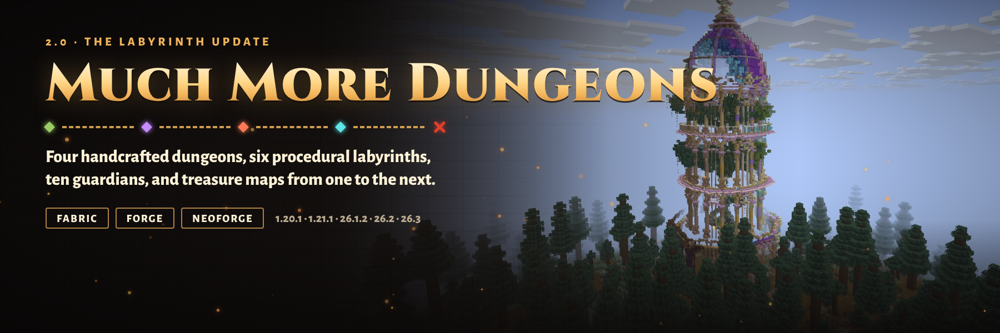

# Much More Dungeons



Four handcrafted dungeons for Minecraft, each with its own biomes, loot tier, themed spawners and a named guardian.
Every dungeon's vault holds a treasure map to the next one: the Smuggler's Villa leads to the Arcane Spire, the Spire
to the Cursed Keep, and the Keep to the Soulfire Crypt.

**2.0 "The Dungeon Trail"** rebuilds the mod around its dungeons: see the [2.0.0 notes](patchnotes/2.0.0.md) and the
[design notes](docs/DESIGN-2.0.md).

## Which jar do I download?

Jar names are `muchmoredungeons-{loader}-{minecraft}-{modVersion}.jar`. Match **both** the Minecraft version and the
loader.

| Minecraft | Java | Fabric jar (needs Fabric API) | NeoForge / Forge jar |
|-----------|------|-------------------------------|----------------------|
| 1.20.1 | 17+ | `…-fabric-1.20.1-….jar` | `…-forge-1.20.1-….jar` (Forge 47) |
| 1.21.1 | 21+ | `…-fabric-1.21.1-….jar` | `…-neoforge-1.21.1-….jar` |
| 26.1.2 | 25+ | `…-fabric-26.1.2-….jar` | `…-neoforge-26.1.2-….jar` |
| 26.2 | 25+ | `…-fabric-26.2-….jar` | `…-neoforge-26.2-….jar` |
| 26.3 | 25+ | `…-fabric-26.3-….jar` | `…-neoforge-26.3-….jar` |

Install it on the server and on clients (single player generates its world on the client).

## The dungeons

| Dungeon (id) | Tier | Biomes | Spawners | Guardian |
|--------------|------|--------|----------|----------|
| Smuggler's Villa (`outdoor_villa`) | 1 | plains, sunflower plains, meadows, flower forests, savannas | pillager | Smuggler Chief (vindicator) |
| Arcane Spire (`tower_dungeon`) | 2 | `#minecraft:is_forest`, `#minecraft:is_taiga` | zombie, skeleton, spider, witch | Spire Illusionist (illusioner) |
| Cursed Keep (`dungeon_t2`) | 3 | deserts, badlands, jungles, swamps, savannas | named zombies, husk and witch, skeleton | Keep Warlord (zombie) |
| Soulfire Crypt (`soulfire_crypt`) | 4 | snowy and cold biomes | wither skeleton, blaze | Cinder Warden (wither skeleton) |

- **Loot**: every chest draws from its dungeon's table (`chests/<id>`), the guarded vault from `chests/<id>_vault`.
  Enchantment levels rise from 5-15 in the Villa to 30-39 in the Crypt.
- **Treasure maps**: each vault has a map to the next dungeon, and regular chests sometimes do.
- **Guardians** spawn once when the dungeon generates: named, persistent, stronger than their kind, and their weapon
  always drops.
- **Advancements**: a Much More Dungeons tab with one advancement per dungeon found, one per guardian defeated (with
  experience) and Dungeon Delver for entering all four.
- **Placement**: centred on a chunk, only on dry ground at or above sea level with a limited slope, kept four chunks
  from village placements. Find them with `/locate structure muchmoredungeons:<id>` or
  `/locate structure #muchmoredungeons:dungeons`.

## Configuration

`config/muchmoredungeons.json` is written on first start, with comments:

| Key | What it does |
|-----|--------------|
| `guardians` | Spawn each dungeon's guardian (default `true`) |
| `dungeons.<id>.enabled` | Generate this dungeon at all (default `true`) |
| `dungeons.<id>.chance` | Share of valid spots that get the dungeon, 0 to 1 (default `1.0`) |

Changes apply after a restart, to newly generated chunks. Everything else is datapack data under
`data/muchmoredungeons/`:

| File | Controls |
|------|----------|
| `worldgen/structure_set/<id>_set.json` | spacing, separation, salt, village clearance |
| `tags/worldgen/biome/has_structure/<id>.json` | biomes |
| `worldgen/structure/<id>.json` | terrain adaptation, spawn overrides |
| `loot_table/chests/<id>.json`, `<id>_vault.json` (`loot_tables/` on 1.20.1) | loot |
| `advancement/` (`advancements/` on 1.20.1) | advancements |
| `structure/<id>.nbt` (`structures/` on 1.20.1) | the templates; a `guardian` data marker places the guardian, `chest` and `vault` markers place a loot chest |

`/muchmoredungeons inspect [pos] [fill]` (permission level 2) reports what the dungeon at a position holds: chests by
loot table, spawners by mob, its guardian and where its vault is.

## Upgrading from 1.x

Structure, structure type, piece, template and loot table ids are unchanged, so dungeons already generated stay in
your world. Newly generated chunks use the 2.0 placement and spacing, so dungeons may appear in different places than
1.x would have put them.

## Building

Each Minecraft version is a separate MultiLoader Gradle workspace (`common/`, `fabric/` and `neoforge/`, or `forge/` on
1.20.1). Gradle needs the workspace's Java version: 17 for 1.20.1, 21 for 1.21.1, 25 for 26.x.

```bash
cd 26.3
./gradlew build          # jars in fabric/build/libs and neoforge/build/libs; runs the unit tests
```

Prebuilt release jars go in `releases/` for the publish workflow. Release notes for a version live in
`patchnotes/<version>.md`.

## Tools

- [`tools/datagen.py`](tools/datagen.py): writes loot tables, advancements, tags, structures and structure sets into
  every workspace in that version's format. Edit the tables there, not the JSON.
- [`tools/templates.py`](tools/templates.py) and [`tools/generate_soulfire_crypt.py`](tools/generate_soulfire_crypt.py):
  fix and generate the structure templates.
- [`tools/qa/`](tools/qa): dev servers and a real game client under Xvfb. `dungeon_checks.py` checks locating,
  natural generation, `/place`, loot tables, spawners, guardians, advancements and the logs; `run_matrix.sh` runs it on
  every build; `marketing_shots.py` captures the listing screenshots; `rarity.py` measures how far the nearest dungeons
  are.
- [`marketing/`](marketing): the CurseForge/Modrinth description, listing images and how to regenerate them.

## Links

- [Discord](https://discord.gg/SAmd9fhNhr)
- [Modrinth](https://modrinth.com/mod/much-more-dungeons)
- [Source and issues](https://github.com/MeherBenSalem/Much-More-Dungeons)
- [Support us](https://nightbeam.dev/support)

## Contributing

See [CONTRIBUTING.md](CONTRIBUTING.md). Please follow the [Code of Conduct](CODE_OF_CONDUCT.md).

## Security

See [.github/SECURITY.md](.github/SECURITY.md).

## License

[Apache License 2.0](LICENSE).
